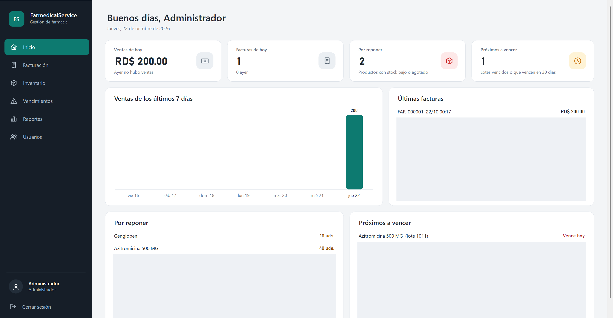
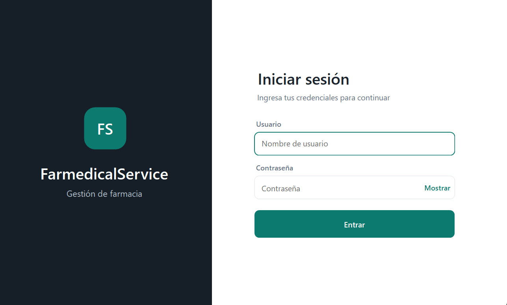
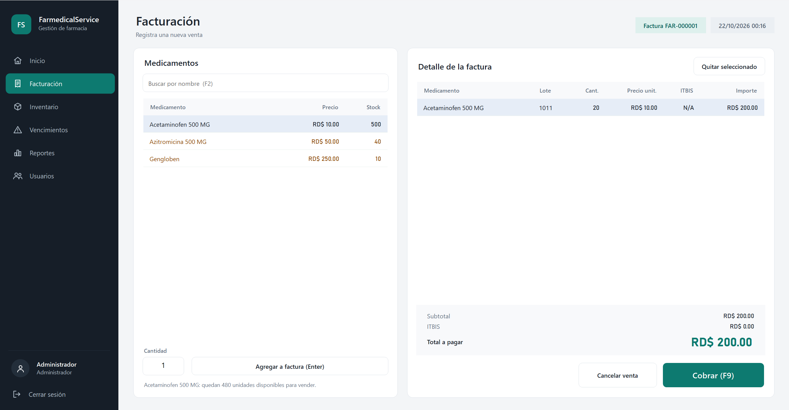
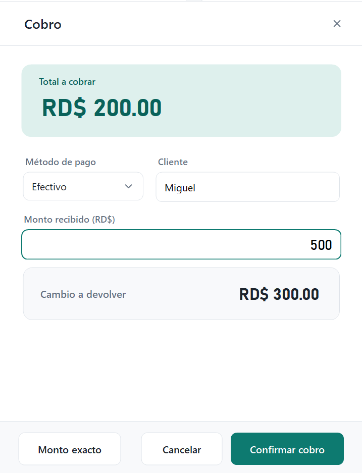
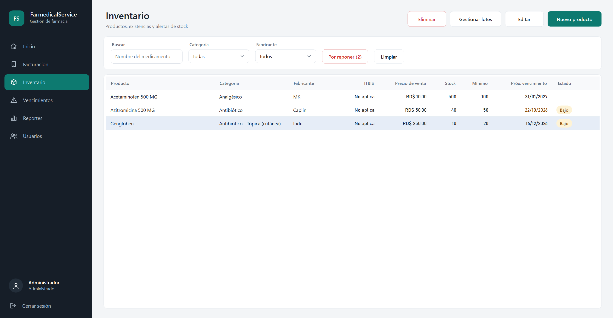
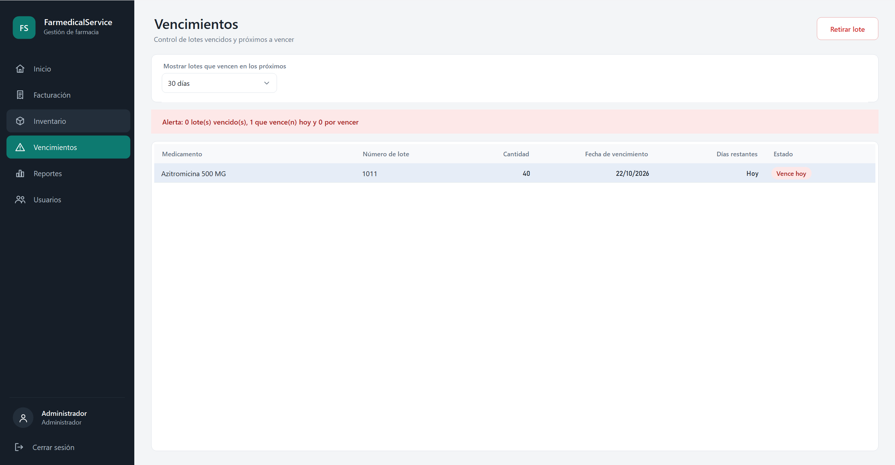
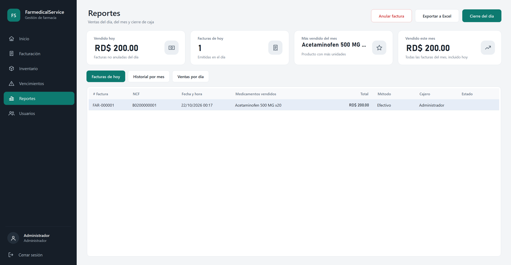
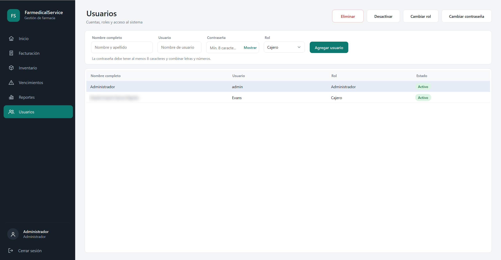

# Farmedical Service

Sistema de punto de venta e inventario para farmacias, hecho con **C#, .NET 10, Windows Forms y SQLite**. Pensado para el mercado dominicano: facturación con ITBIS, comprobantes con NCF y control de lotes por fecha de vencimiento.



## Descarga

**[Descargar el ejecutable para Windows (última versión)](https://github.com/Arkanait056/FarmedicalService/releases/latest)**

No requiere instalar .NET. Descomprime el `.zip` y abre `FarmedicalService.exe`. La base de datos (`Farmedical.db`) se crea sola junto al ejecutable la primera vez.

> Windows puede mostrar la advertencia "SmartScreen" porque el programa no está firmado digitalmente. Pulsa **Más información → Ejecutar de todas formas**.

### Acceso de prueba

- **Usuario:** `admin`
- **Contraseña:** `admin123`

> Es solo para pruebas y demostración. Cambia la contraseña desde el módulo de Usuarios antes de usar el sistema con datos reales.

## Características

- **Panel de inicio** con ventas del día, ventas de los últimos 7 días, últimas facturas, productos por reponer y lotes próximos a vencer.
- **Facturación** con ITBIS, búsqueda rápida (`F2`), cobro con `F9`, método de pago, cliente y cálculo automático del cambio.
- **Comprobantes fiscales (NCF)** con serie y secuencial configurables.
- **Anulación de facturas** con motivo y registro de quién la realizó.
- **Inventario por lotes** con rotación **FEFO** (primero en vencer, primero en salir) y alertas de stock bajo.
- **Control de vencimientos** de lotes vencidos, que vencen hoy o próximos a vencer, con opción de retirar el lote.
- **Productos, categorías y fabricantes** (marca y genérico).
- **Roles de usuario:** Administrador, Supervisor y Cajero.
- **Cierre del día** con cuadre de caja (efectivo contado vs. esperado).
- **Reportes** de ventas del día, historial por mes y ventas por día, con **exportación a Excel**.
- **Contraseñas protegidas** con PBKDF2-SHA256 y sal aleatoria.
- **Interfaz propia** con escalado correcto a 100 %, 125 % y 150 % de DPI.

## Capturas

### Inicio de sesión y panel principal

| Inicio de sesión | Panel de inicio |
|---|---|
|  |  |

### Facturación y cobro



<p align="center">
  
</p>

### Inventario y vencimientos





### Reportes y usuarios





## Tecnologías

- C# con .NET 10
- Windows Forms
- SQLite (`Microsoft.Data.Sqlite`)
- Interfaz personalizada dibujada con GDI+

## Ejecutar desde el código

Requisitos:

- Windows
- [.NET 10 SDK](https://dotnet.microsoft.com/download/dotnet/10.0)

```bash
git clone https://github.com/Arkanait056/FarmedicalService.git
cd FarmedicalService
dotnet run
```

Para generar un ejecutable único:

```bash
dotnet publish -c Release -r win-x64 --self-contained true -p:PublishSingleFile=true -p:IncludeNativeLibrariesForSelfExtract=true
```

El resultado queda en `bin/Release/net10.0-windows/win-x64/publish/`.

## Estructura del proyecto

```
FarmedicalService/
├── Database/   Acceso a datos (SQLite) y repositorios
├── Forms/      Pantallas: login, facturación, inventario, reportes, usuarios...
├── Models/     Entidades: Producto, Lote, Factura, Usuario...
├── UI/         Capa de interfaz propia: tema, controles, iconos, diálogos
├── FarmaciaConfig.cs   Datos fiscales del recibo
└── Program.cs
```

La interfaz usa una capa propia en `UI/`:

- `Theme.cs`: paleta (verde farmacia) y tipografía (Segoe UI).
- `Ui.cs`: escalado por DPI (`Ui.S`), fábricas de campos y estilo de tablas.
- `Controls.cs`: `Card`, `AppButton`, `NavItem`, `KpiCard`, `ModuleCard`, `IconBadge`.
- `Icons.cs`: iconos vectoriales dibujados con GDI+.
- `PageForm.cs` / `DialogForm.cs`: base de las pantallas y de los diálogos.

## Datos fiscales

`FarmaciaConfig.cs` contiene el nombre, RNC, dirección, teléfono y la serie/secuencial del NCF que se imprimen en el recibo. Los valores incluidos son de ejemplo: reemplázalos y valida el rango autorizado por la DGII antes de emitir comprobantes reales.

Las bases de datos existentes se actualizan solas (columnas nuevas para anulaciones, método de pago, NCF y cuadre de caja).

